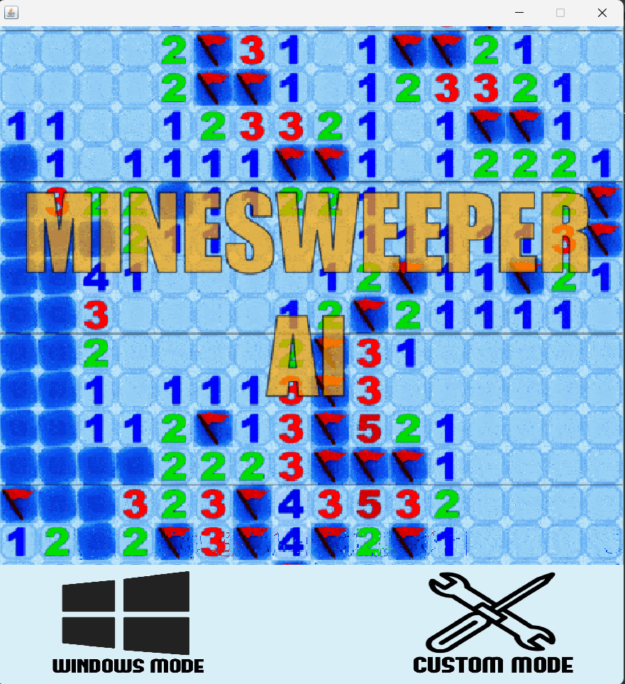
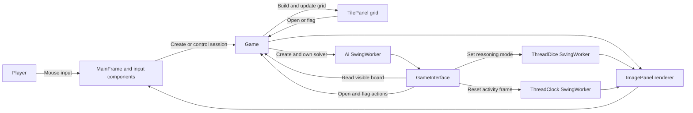
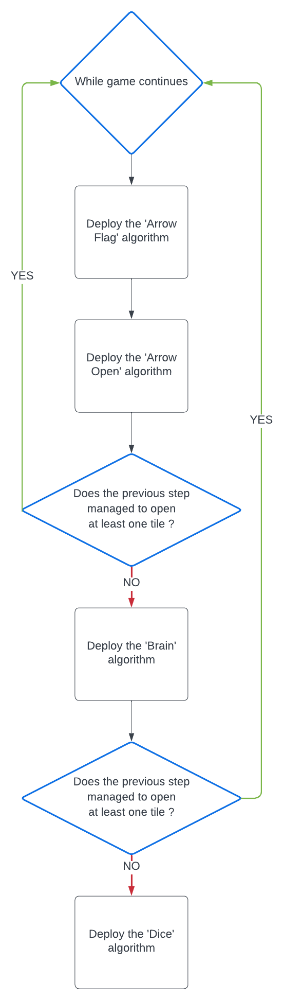
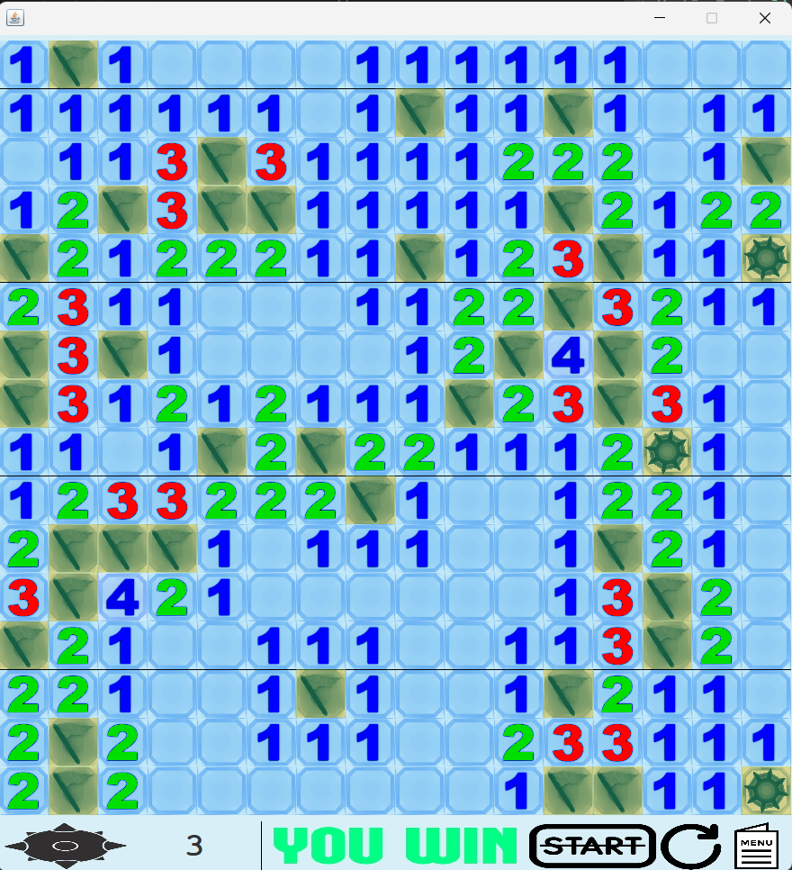

# Minesweeper AI

**A complete Java desktop game paired with a constraint-driven autonomous solver**

Minesweeper AI combines a playable, image-rich Minesweeper implementation with an agent that reasons from the same visible clues available to a human player. The solver moves from deterministic deductions to constraint enumeration and, only when certainty is exhausted, a solution-informed guess. The result is both an interactive game and a visual demonstration of search, state modeling, and decision-making under incomplete information.



## Overview

The application recreates the complete Minesweeper session lifecycle in a Java Swing interface: board selection, randomized mine placement, safe first move, recursive empty-region expansion, flagging, win/loss detection, restart, and return-to-menu navigation.

Players can choose the classic Beginner, Intermediate, and Expert configurations or enter a custom row, column, and mine count. At any point in a session, the built-in agent can take control through the **START** control. A live status area then visualizes whether the solver is applying a deterministic rule, evaluating constraints, or making a fallback selection.

The central engineering challenge is not rendering the board; it is converting a partially observed grid into decisions that remain consistent with every revealed clue. The project addresses that challenge with:

- **Layered reasoning:** inexpensive local rules run before exponential search.
- **Constraint-frontier decomposition:** related hidden cells are solved together while independent regions are separated.
- **Backtracking with early rejection:** impossible assignments are discarded before full enumeration.
- **Consensus actions:** cells that have the same value in every valid assignment are opened or flagged with certainty.
- **Responsive execution:** solver and status animations run through dedicated `SwingWorker` tasks with explicit lifecycle cleanup.

## Technical Highlights

### Deterministic deductions before search

The Arrow stage repeatedly scans revealed numbered cells and applies the two canonical Minesweeper invariants:

1. If a clue's remaining mine count equals its number of closed neighbors, every one of those neighbors is a mine.
2. If the number of adjacent flags already equals the clue, every remaining closed neighbor is safe.

These passes avoid unnecessary enumeration and immediately feed new information back into the board. Any opened zero-value cell also triggers recursive flood fill, exposing its connected empty region and boundary clues in a single action.

### Constraint solving over independent frontiers

When local deductions stall, the Brain stage snapshots the visible board and identifies the **frontier**: closed cells adjacent to at least one revealed clue. It then groups frontier cells by shared clue dependencies using a queue-based graph traversal.

Each group is enumerated independently as mine/empty Boolean assignments. During recursion, an assignment is rejected as soon as it:

- places more adjacent mines than a clue permits,
- marks too many adjacent cells empty to satisfy a clue,
- exceeds the board's total mine count, or
- violates the exact remaining mine total during the endgame.

This design keeps the worst-case `O(2^k)` search local to each constraint-connected group instead of treating every hidden cell as one monolithic search space.

### Certainty extraction and solution-informed fallback

After enumeration, the solver compares each cell across all valid assignments:

- a cell marked as a mine in every assignment is flagged,
- a cell marked as empty in every assignment is opened,
- otherwise, the Dice stage selects the cell with the strongest empty support among the accumulated valid assignments.

The agent therefore guesses only after both deterministic reasoning and exhaustive constraint agreement fail to produce a safe move.

### Explicit board and worker lifecycles

The game keeps the hidden mine layout, player-visible state, and flood-fill visitation state in separate matrices. This separation lets the UI and solver share a controlled view of the session without giving the solver direct access to hidden mines.

The first move is guaranteed safe by reserving a non-mine position during generation and relocating a mine there if the opening cell is mined. Solver activity, its clock animation, and its reasoning-mode indicator are implemented as separate `SwingWorker` tasks. The game cancels all three workers when a session ends, restarts, or returns to the menu.

## Architecture

The application uses a compact layered design. Swing components translate mouse input into game operations, `Game` owns the authoritative session state, and `GameInterface` exposes only the state and actions required by the solver.



### Component responsibilities

| Component | Responsibility |
|---|---|
| `MainFrame` | Owns top-level navigation and switches menu, configuration, game, and close views with `CardLayout`. |
| `Game` | Generates boards, enforces rules, maintains state matrices, renders session outcomes, and manages worker lifecycles. |
| `TilePanel` and input listeners | Convert mouse interactions into open, flag, menu, restart, preview, and solver-start actions. |
| `GameInterface` | Provides the solver with visible state queries and controlled game commands. |
| `Ai` | Coordinates Arrow deductions, frontier construction, backtracking enumeration, consensus decisions, and Dice fallback. |
| `ThreadClock` and `ThreadDice` | Publish animated activity and current reasoning-stage frames without blocking interaction handling. |

## Solver Pipeline

The solver begins at the center of the board, then cycles through increasingly expensive reasoning stages until the game reaches a terminal state.

1. **Arrow Flag** identifies mines forced by local clue counts.
2. **Arrow Open** reveals cells proven safe by existing flags.
3. **Brain** partitions the frontier and enumerates every constraint-consistent assignment for each group.
4. **Consensus evaluation** applies any mine or empty value shared by all valid assignments.
5. **Dice** opens the best-supported empty candidate when no certain move remains.
6. Every newly revealed clue restarts the cycle from the deterministic Arrow stage.

<p align="center">
  
</p>



## Technology Stack

| Layer / Area | Technology | Role in the Project |
|---|---|---|
| Language and algorithms | Java SE | Implements board generation, recursive flood fill, graph traversal, constraint checks, and backtracking search. |
| Desktop interface | Java Swing | Provides the application window, panels, buttons, labels, image-backed tiles, and event-driven interaction model. |
| Layout and rendering | Java AWT | Supplies `CardLayout`, `GridLayout`, `BorderLayout`, graphics primitives, colors, fonts, and mouse/window events. |
| Background execution | `SwingWorker` | Runs the solver and animated status workers outside direct event callbacks and publishes visual updates. |
| Data structures | Java Collections Framework | Uses `HashSet`, `HashMap`, `ArrayList`, and `LinkedList` for mine uniqueness, component lookup, solution storage, and frontier traversal. |
| Build and packaging | Apache Maven | Defines the project coordinates, compiler configuration, resources, dependencies, and standard build lifecycle. |
| Visual resources | PNG, JPEG, GIF, `ImageIcon` | Delivers the custom board theme, animated menu, controls, solver-state indicators, and win/loss presentation. |

## Project Structure

```text
.
├── pom.xml                         # Maven build and project metadata
├── images/                         # README screenshots and solver flowchart
└── src/main/
    ├── java/groupid/
    │   ├── MainFrame.java          # Application entry point and view navigation
    │   ├── Game.java               # Board state, rules, rendering, and lifecycle
    │   ├── Ai.java                 # Layered autonomous solver
    │   ├── GameInterface.java      # Controlled bridge between solver and game
    │   ├── TilePanel.java          # Interactive board cells
    │   ├── ImagePanel.java         # Image-backed Swing rendering
    │   ├── PanelButtonListener.java
    │   ├── ThreadClock.java         # Activity animation worker
    │   └── ThreadDice.java          # Solver-stage indicator worker
    └── resources/                  # Tile art, controls, animations, and board data
```

## Running the Project

### Prerequisites

- JDK 8 or newer with desktop UI support
- Apache Maven 3
- A graphical desktop environment

Clone and run the project from the repository root so the application can resolve its image resources:

```bash
git clone https://github.com/arda-tuz/minesweeper_ai.git
cd minesweeper_ai
mvn -Dmaven.compiler.source=8 -Dmaven.compiler.target=8 compile
java -cp target/classes groupid.MainFrame
```

### Controls

- Choose **Windows Mode** for Beginner (`9 × 9`, 10 mines), Intermediate (`16 × 16`, 40 mines), or Expert (`30 × 16`, 99 mines).
- Choose **Custom Mode** to enter row, column, and mine values through the on-screen keypad.
- Left-click a tile to open it; right-click to place or remove a flag.
- Use the eye control to toggle the mine-layout preview.
- Press **START** to hand the current session to the autonomous solver.

## Engineering Validation

The implementation protects its central invariants at runtime: hidden and visible state remain separate, the first move cannot detonate a mine, clue-inconsistent search branches are pruned, win/loss transitions stop background workers, and restart/menu actions dispose of the active session workers.

The Maven build compiles all application sources and copies the complete visual resource set. On current JDK releases, the explicit Java 8 compatibility flags shown above provide a reproducible build while preserving the project's original language-level implementation.

## Closing Perspective

Minesweeper AI brings together desktop UI engineering, recursive game mechanics, asynchronous task management, graph-based problem decomposition, and constraint-driven search in one cohesive application. Its layered solver makes the reasoning process visible while keeping the game engine playable independently, demonstrating how algorithmic depth can be integrated into a complete interactive system.
